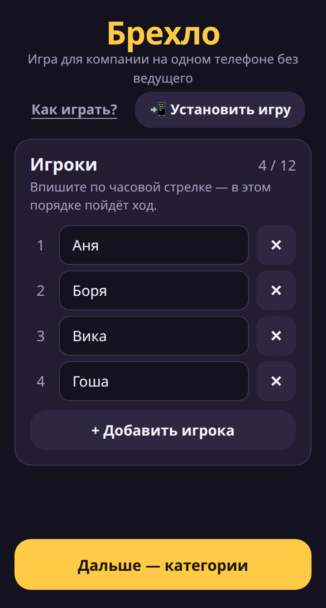
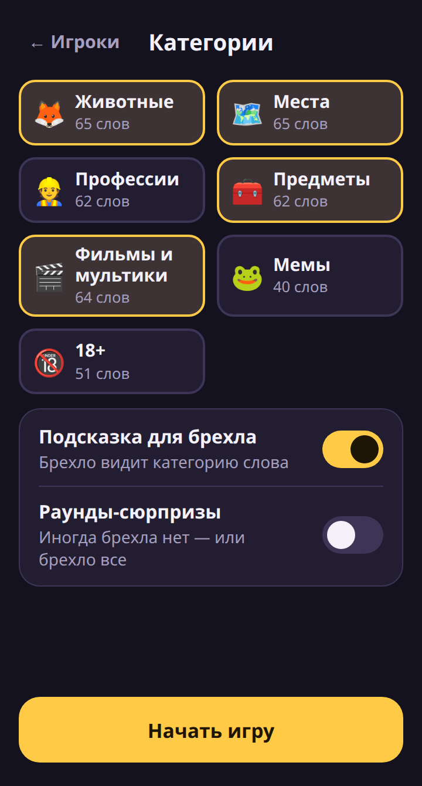
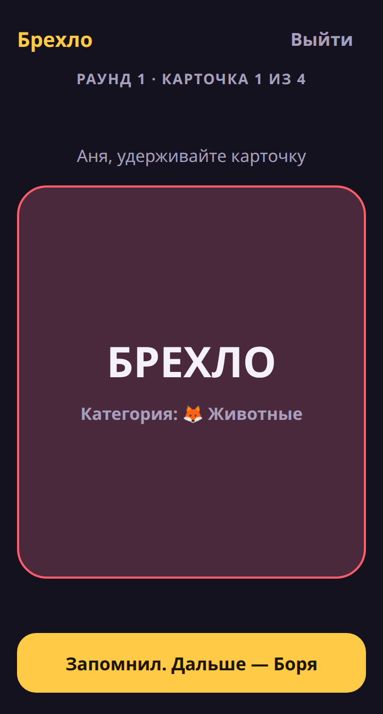
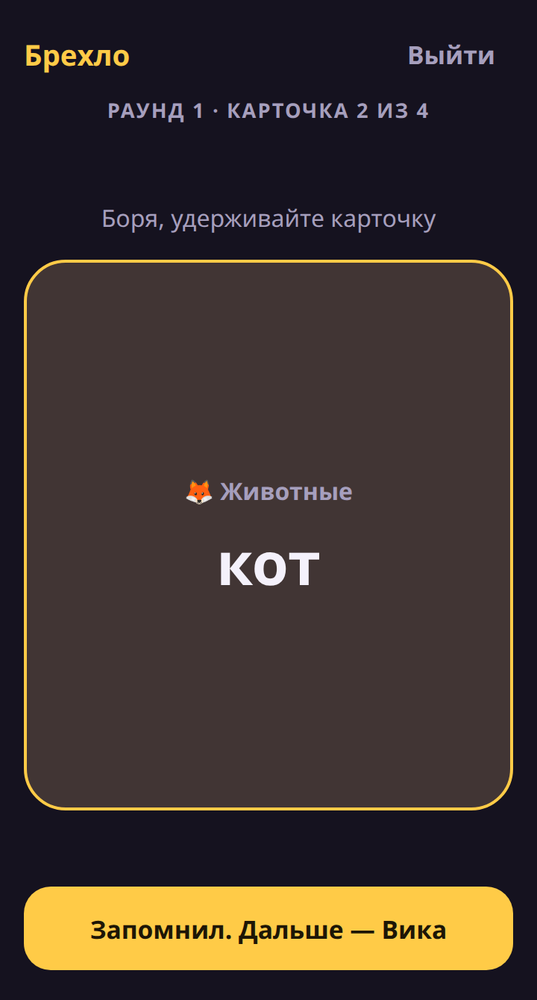
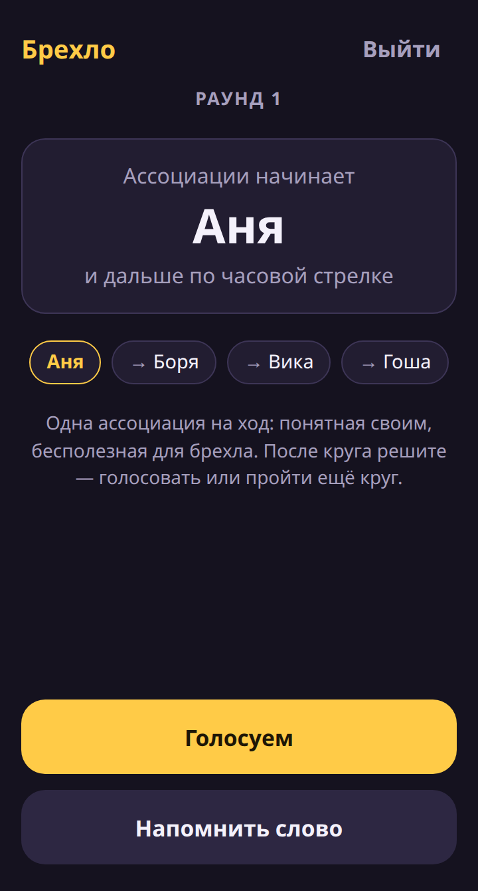
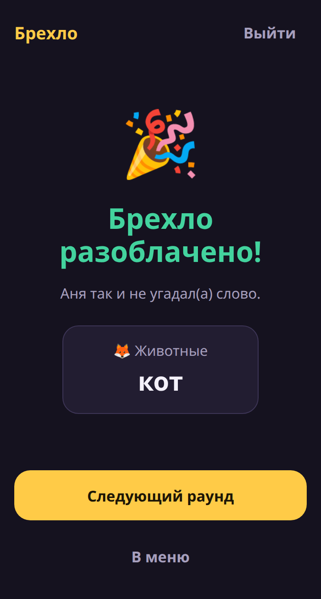

# Брехло

[](https://github.com/AntonChehov/brehlo-game/actions/workflows/deploy.yml)

Вечериночная игра для компании на **одном телефоне** — без ведущего.

**▶ Играть: [antonchehov.github.io/brehlo-game](https://antonchehov.github.io/brehlo-game/)** — откройте на телефоне и установите на главный экран, дальше игра работает без интернета.

У всех игроков одно и то же слово, а у одного вместо слова — **«БРЕХЛО»**. По кругу каждый называет ассоциацию: понятную своим, но бесполезную для брехла. Брехло делает вид, что всё знает. Потом голосуете: кто врёт?

Игра родилась, когда нас было слишком мало, чтобы кто-то один сидел ведущим и не играл. Теперь ведущий — телефон.

| Игроки | Категории | Карточка брехла |
|---|---|---|
|  |  |  |
| **Карточка со словом** | **Ход по кругу** | **Итог раунда** |
|  |  |  |

## Возможности

- 📱 **Один телефон, передаётся по кругу.** Слово видно, только пока палец держит карточку.
- 🗂 **7 категорий, ~400 слов:** животные, места, профессии, предметы, фильмы и мультики, мемы, 18+. Можно выбрать одну или смешать несколько.
- 💡 **Подсказка для брехла** (по умолчанию включена) — брехло видит категорию слова.
- 🎲 **Раунды-сюрпризы:** изредка брехла нет вовсе — или брехло все.
- 🔁 Ход переходит по часовой стрелке, слова не повторяются между раундами.
- 🕵️ Пойманное брехло может отыграться, назвав слово.
- 🔔 **«Напомнить слово»** — забывший игрок снова смотрит свою карточку (брехлу тоже можно, чтобы не выделяться).
- 📲 **Установка на телефон** в один тап: системный диалог на Android, инструкция для iPhone. После установки игра работает без интернета, состояние переживает перезагрузку.

## Правила

1. Телефон идёт по кругу, каждый тайком смотрит свою карточку.
2. Начиная с первого игрока, каждый называет одну ассоциацию к слову.
3. После круга решаете: голосовать или ещё круг. Забыли слово — «Напомнить слово».
4. Обвинили невиновного — брехло победило. Вычислили брехло — у него последний шанс назвать слово.
5. Следующий раунд начинает следующий по часовой стрелке.

## Разработка

```bash
pnpm install
pnpm dev        # локальный сервер
pnpm test       # unit + интеграционные тесты (Vitest)
pnpm lint       # линтер (oxlint, включая .vue)
pnpm build      # проверка типов + production-сборка
pnpm icons      # перегенерировать иконки PWA из public/favicon.svg
```

**Стек:** Vue 3 (Composition API, `<script setup>`), TypeScript strict, Vite, vite-plugin-pwa, Vitest + Vue Test Utils, oxlint. CI на GitHub Actions: линтер, тесты и сборка на каждый PR, деплой на GitHub Pages из `main`. Без UI-библиотек и стейт-менеджеров: ~42 КБ JS в gzip.

### Архитектура

```
src/
├── game/          # чистая игровая логика на TS — без Vue, покрыта тестами
│   ├── types.ts   #   Round, Card, Outcome…
│   └── engine.ts  #   выбор слова и брехла, порядок хода, исход голосования
├── composables/
│   └── useGame.ts # состояние партии + сохранение в localStorage
├── screens/       # setup → deal → play → vote → result
├── components/    # диалоги, переключатели
└── data/packs/    # наборы слов
```

Логика отделена от UI намеренно: `engine.ts` можно переиспользовать в нативной версии.

### Свой набор слов

Добавьте файл в `src/data/packs/` по образцу существующих и подключите его в `index.ts`. Тест проверит, что нет дублей между наборами.

## Дорожная карта

См. [docs/roadmap.md](docs/roadmap.md).

## Лицензия

MIT
